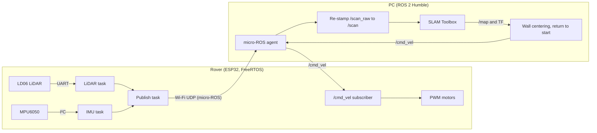

# ECEPILOT — Autonomous ESP32 rover with micro-ROS and SLAM

A Waveshare rover driven by an ESP32 that maps its surroundings with a 2D LiDAR and drives itself along a corridor.
The firmware publishes sensor data over Wi-Fi through **micro-ROS**, and a **ROS 2 Humble** stack on the PC handles localisation, mapping (**SLAM Toolbox**) and navigation.

Fourth-year engineering project (ECE Paris, Embedded Systems major, 2025-2026), built by a team of three.


## What the project does

| Feature | Where | Details |
|---|---|---|
| LD06 LiDAR acquisition | `firmware/` | Serial frame decoding (230,400 baud), lock-free double buffer, dedicated FreeRTOS task |
| MPU6050 inertial unit | `firmware/` | I²C readout, axes remapped to the robot frame, published as `sensor_msgs/Imu` |
| Motor control | `firmware/` | `/cmd_vel` subscriber, differential PWM drive |
| micro-ROS link | `firmware/` | Wi-Fi UDP transport, agent name resolution (`microros-agent.local`) with fallback addresses, automatic reconnection |
| SLAM mapping | `ros2/` | SLAM Toolbox in pure scan-matching mode, scan re-stamping, map export |
| Laser odometry | `ros2/` | RF2O, compared against motor odometry and ground truth |
| Autonomous driving | `ros2/` | Wall centering, end-of-lap detection, return to start (recorded path, A\* or Nav2) |
| 2D simulator | `ros2/` | Simulated robot and LiDAR under pygame, to test the whole chain without hardware |
| Remote control | `hardware/` | ATmega328P + ESP-01S board designed in KiCad |

## Architecture



The two ESP32 cores are used separately: sensor acquisition on core 1, network publishing on core 0.
Design decisions are detailed in [docs/ARCHITECTURE.md](docs/ARCHITECTURE.md) and [docs/SLAM_IMPLEMENTATION.md](docs/SLAM_IMPLEMENTATION.md).

## Repository layout

```
├── firmware/      ESP32 firmware (PlatformIO): LiDAR, IMU, motors, micro-ROS
├── ros2/          ROS 2 stack: Python nodes, launchers, SLAM/Nav2 configurations, simulator
│   ├── config/        SLAM Toolbox, RF2O and Nav2 parameters
│   ├── tools/         Tests, diagnostics and experiments (loop closure, return to start)
│   ├── legacy/        Earlier versions of the nodes, kept for reference
│   └── track_images/  Preparation of the simulated track image
├── hardware/      Remote-control PCB (KiCad) and I²C test bench
├── tools/         Serial LiDAR viewer (PyQtGraph)
├── docs/          Architecture, performance, tuning notes
└── milestones/    Earlier stages of the project, each in the state it was in at the time
```

## Quick start

### 1. Simulation (no hardware needed)

Requirements: Ubuntu 22.04, ROS 2 Humble, `ros-humble-slam-toolbox`, Python 3.10.

```bash
git clone https://github.com/shiva-tilhoo/ecepilot-autonomous-robot.git
cd ecepilot-autonomous-robot/ros2
pip install -r requirements.txt
./start_auto_slam_only.sh
```

In the pygame window, the `A` key toggles autonomous driving and the arrow keys take control back. The map builds live in RViz (`rviz2 -d rviz_config.rviz`).

### 2. Real robot

```bash
# Firmware
cd firmware
cp include/secrets.example.h include/secrets.h   # fill in the Wi-Fi network
pio run --target upload

# PC: micro-ROS agent, then the mapping stack
ros2 run micro_ros_agent micro_ros_agent udp4 --port 8888
cd ../ros2 && ./start_robot_mapping_auto.sh
```

The agent is installed with [micro_ros_setup](https://github.com/micro-ROS/micro_ros_setup) (`humble` branch). The full procedure is in [docs/QUICKSTART.md](docs/QUICKSTART.md).

## Hardware

| Item | Reference |
|---|---|
| Chassis | Waveshare rover |
| Microcontroller | ESP32 (`esp32dev` board) |
| LiDAR | LDROBOT LD06, 360°, UART on GPIO16 |
| Inertial unit | MPU6050 (I²C) |
| Remote control | ATmega328P + ESP-01S, joystick, buzzer, RGB LED |

## Project history

| Milestone | Period | Content |
|---|---|---|
| Remote control and test bench (`hardware/`, `tools/`) | autumn 2025 | ATmega328P + ESP-01S PCB, I²C bus test, LiDAR viewer over a serial link |
| [01 — LiDAR and IMU telemetry](milestones/01_lidar_imu_telemetry) | January 2026 | First micro-ROS firmware, C++ ROS 2 nodes, RViz visualisation |
| [02 — On-board reactive navigation](milestones/02_reactive_navigation_firmware) | early 2026 | Obstacle avoidance computed directly on the ESP32 |
| [03 — Custom SLAM and EKF fusion](milestones/03_custom_slam_ekf_fusion) | February 2026 | Hand-written ICP SLAM, IMU filters (FFT, FIR, Kalman), odometry/IMU fusion |
| Current version (`firmware/`, `ros2/`) | March 2026 | SLAM Toolbox, RF2O, simulator, wall centering, return to start |

The milestones also keep the approaches that were dropped (frontier exploration, area coverage): they explain the choices made in the final version.

## Known limitations

- Return to start (recorded path, A\*, Nav2) is implemented in the simulator; its real-robot counterpart lives in `ros2/tools/` and is still experimental.
- Motor odometry is not used by SLAM (its covariance is deliberately very high): localisation relies on the LiDAR.
- Motors are disabled by default in `firmware/include/config.h` (`ENABLE_MOTORS 0`), so sensors can be tested safely.
- Scripts in `ros2/legacy/` are archived as they were and are no longer maintained.

The colcon workspace hosting the micro-ROS agent is looked up in `$HOME/microros_ece_ws`; set `MICROROS_WS` to point to another one.

## Team

Designed and developed by three people: **Mathéo Léon**, **Amandine Soyez** and **Shiva Tilhoo**.

We wrote the code together on a shared development machine rather than each on our own: the firmware, the ROS 2 stack and the electronics board are joint work.
This repository is my reference copy of the project, reorganised and documented so that it can be reproduced on any machine.

## Third-party dependencies

[micro-ROS](https://micro.ros.org/) · [SLAM Toolbox](https://github.com/SteveMacenski/slam_toolbox) · [rf2o_laser_odometry](https://github.com/MAPIRlab/rf2o_laser_odometry) · [Nav2](https://nav2.org/) · [MPU6050 (ElectronicCats)](https://github.com/ElectronicCats/mpu6050)
